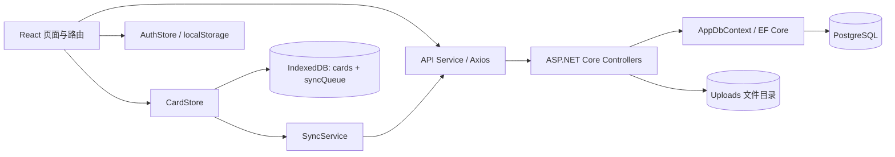

# AutoTesting_Practice：仓库分析与功能扩展准备

分析日期：2026-10-08  
分析基线：本地 main，提交 f5d5f1e999de983fb6f97218885a4f697457d961，提交日期 2026-09-02。  
主要范围：AutoTest_Practice_Platform.API 与 AutoTest_Practice_Platform.Client。未分析或运行 Test、AutoTest_Practice_Platform.Tests 及其他测试工程。  
本地远程地址与用户提供的 GitHub 仓库一致；当前网络无法解析 GitHub，因此没有确认远端 main 是否有更新。

本次仅新增此分析文档，没有修改业务代码、数据库结构或运行配置。构建产生的文件位于已有的忽略目录。没有启动 API，因为现有启动流程会自动迁移数据库并可能写入种子数据。

## 1. 项目定位与总体判断

当前实现是一个面向自动化测试练习的业务靶场，提供认证、任务、资源、文件、模拟报表和支付测试卡片数据池。它已经具备继续增加业务场景的基础。

目前的 TaskItem 表示任务记录；ReportRecord 表示报表记录。现有两个工程中没有发现自动化脚本执行器、后台调度服务、执行节点管理或任务执行结果采集流程。Flaky 接口和耗时报表属于明确设计的练习场景：前者随机返回 500，后者在当前 HTTP 请求内等待 2–5 秒再生成记录。扩展真实执行能力时，需要增加执行模型和后台处理流程。

建议保留现有单体 API 与 React SPA 的结构，优先统一接口契约、修复已有数据一致性问题，再按业务模块增加功能。目前没有必要先拆分微服务或全面重写。

## 2. 技术结构与运行方式

| 部分 | 已有实现 | 扩展时的主要约束 |
| --- | --- | --- |
| 后端 | ASP.NET Core Web API，目标 net10.0 | 单一 Web 工程，业务逻辑多数直接位于 Controller |
| 持久化 | EF Core + Npgsql + PostgreSQL | 数据库结构以 API/Migrations 为准 |
| 认证 | JWT Bearer、PBKDF2 密码哈希、前端自动刷新 | Refresh Token 和退出失效流程尚未闭环 |
| 前端 | React 19、TypeScript 6、Vite 8、React Router 7 | 路由页面全部静态导入；尚未按路由拆包 |
| 组件与样式 | Tailwind CSS 4、shadcn/ui、Radix、Lucide、Sonner | 可复用 src/components/ui，当前页面大量使用固定颜色 |
| 前端状态 | Zustand | 仅认证和卡片有全局 Store；其他页面使用局部状态 |
| 离线数据 | Dexie / IndexedDB | 仅卡片模块支持本地写入与同步队列 |
| PWA | vite-plugin-pwa / Workbox | 已缓存应用资源，未配置业务 API 的运行时缓存 |
| 发布 | win-x64、自包含、单文件后端；API 托管 SPA | 本地发布脚本不在当前 Git 提交中 |

上述版本是项目声明或本次构建结果，不代表对外部依赖最新版本的核查。

开发时，Client 监听 5173，API 显式监听 5289。Axios 优先使用 VITE_API_URL，否则访问当前浏览器主机的 HTTP 5289 端口；Vite 未配置 API 代理。

生产托管路径为 Client 构建产物 → API/wwwroot → 后端发布目录。Program.cs 启用默认文件、静态文件和 index.html 回退，支持 SPA 路由刷新。

## 3. API 目录导航

| 入口或目录 | 作用 | 适合承接的扩展 |
| --- | --- | --- |
| [Program.cs](E:/Projects/AutoTestingLearning/Python/AutoTest_Practice_Platform.API/Program.cs:10) | 配置、依赖注入、数据库、认证、限流、CORS、启动流程 | 注册新服务、统一配置与中间件 |
| Controllers | 6 个控制器、33 个 HTTP Action | 新增业务接口；复杂规则宜逐步移至业务服务 |
| Contracts | 请求、响应 record 及实体映射 | 新字段、分页 DTO、校验与接口兼容 |
| Models | User、TaskItem、ResourceItem、FileAsset、ReportRecord、CardItem | 新实体、关系与状态 |
| [AppDbContext.cs](E:/Projects/AutoTestingLearning/Python/AutoTest_Practice_Platform.API/Data/AppDbContext.cs:6) | 6 个 DbSet、长度限制、唯一索引、枚举存储转换 | 新 DbSet、关系、索引、并发字段 |
| Migrations | InitialCreate、AddCardTable 与当前模型快照 | 数据库升级及历史数据转换 |
| Services | 认证、密码哈希、配置加载、初始化数据、Token 黑名单 | 抽取跨接口业务规则 |
| Middleware | 异常转 ProblemDetails | 统一错误协议、日志关联 |

现有后端没有通用 Repository 层。任务、资源、文件、报表和卡片控制器直接访问 AppDbContext。新增简单 CRUD 可以沿用；涉及资源分配、批量导入、状态迁移或跨表事务时，宜增加对应 Service，而不是继续扩大 Controller。

### 3.1 已有接口与认证边界

| 模块 | 路由与能力 | 当前认证要求 |
| --- | --- | --- |
| 认证 | POST /api/auth/register、login、refresh；POST logout；GET me | logout、me 要求登录；其余未要求登录 |
| 任务 | GET/POST /api/tasks；GET/PUT/PATCH/DELETE /api/tasks/{id} | 要求登录 |
| 练习异常 | GET /api/tasks/flaky，20% 概率返回 500 | 显式匿名 |
| 资源 | GET/POST /api/resources；GET/PUT/PATCH/DELETE /api/resources/{id} | 要求登录 |
| 文件 | 列表、详情、upload、upload-image、download、preview、删除 | 要求登录 |
| 报表 | POST /api/report/generate；GET history、/{id} | generate 显式匿名；查询要求登录 |
| 卡片 | GET/POST /api/cards；PUT/DELETE /{id}；GET /getOne | 整个控制器显式匿名 |

查询能力存在差异：任务有 keyword/status/priority 与服务端分页；资源有 status/type；卡片有 cardNumber/expiryDate/isDeleted。资源、文件、报表和卡片均没有服务端分页。

### 3.2 数据模型与关系

| 实体 | 主要字段 | 关系及删除行为 |
| --- | --- | --- |
| User | UserName、Email、PasswordHash、Role、登录时间 | 用户名和邮箱分别唯一；被任务、资源、文件、报表引用 |
| TaskItem | Title、Description、Status、Priority、DueDate | 可选 AssigneeId → User、ResourceId → ResourceItem；API 物理删除 |
| ResourceItem | Name、Type、Url、Status、Tags | 可选 OwnerId → User；Tags 为逗号分隔字符串；API 物理删除 |
| FileAsset | 原始文件名、存储文件名、MIME、Size、StoragePath | 可选 UploadedById → User；数据库记录与磁盘文件分别删除 |
| ReportRecord | Title、Status、DurationMs、Summary | 可选 CreatedById → User；当前没有关联任务或执行记录 |
| CardItem | CardNumber、ExpiryDate、Ccv、IsDeleted、时间 | 独立数据池，没有用户外键；逻辑删除 |

Task/Resource 枚举在数据库中保存为字符串，但当前 JSON 默认使用数值枚举。这两个层面的表示方式需要分别考虑，不能因数据库存字符串而假定 API 也传字符串。

新上传文件没有设置 UploadedById，新生成报表没有设置 CreatedById。用户外键字段的存在还没有形成完整的归属、审计或访问控制。

## 4. Client 目录导航与页面能力

| 入口或目录 | 当前职责 | 扩展入口 |
| --- | --- | --- |
| main.tsx / App.tsx | React 挂载、StrictMode、RouterProvider、全局提示 | 全局 Provider 或应用级初始化 |
| [router/index.tsx](E:/Projects/AutoTestingLearning/Python/AutoTest_Practice_Platform.Client/src/router/index.tsx:12) | 登录、注册、受保护的业务路由 | 注册新页面、按路由延迟加载 |
| [AuthLayout.tsx](E:/Projects/AutoTestingLearning/Python/AutoTest_Practice_Platform.Client/src/components/layouts/AuthLayout.tsx:10) | 路由守卫、当前用户、导航、退出 | 新导航入口、权限显示规则 |
| pages | 页面数据获取、表单、列表与交互 | 新页面；复杂模块宜提取业务组件和 Hook |
| api | Axios 与按业务划分的请求封装 | 新接口、错误处理、请求取消 |
| [api/types.ts](E:/Projects/AutoTestingLearning/Python/AutoTest_Practice_Platform.Client/src/api/types.ts:1) | 手写 TypeScript 契约 | 与后端 Contracts、枚举同步修改 |
| store | AuthStore、CardStore | 跨页面共享或离线模块状态 |
| db | Dexie 表、卡片 Repository、同步队列 Repository | 离线表结构升级与队列协议 |
| components/ui | 已生成的 shadcn/ui 组件与 TimePicker | 优先复用已有组件 |
| utils/dateTime.ts | UTC+8 当前时间、日期显示字符串 | 统一时间协议时需要调整职责 |

| 页面 | 已有行为 | 尚未连接或实现的能力 |
| --- | --- | --- |
| Login / Register | 认证、保存 Token、自动进入控制台 | 密码策略、用户管理与角色配置 |
| Dashboard | Flaky 请求、模拟耗时报表 | 汇总统计、真实执行状态 |
| TaskList | 查询、分页、当前页标题排序、新建、编辑、删除 | 负责人/资源选择、全局排序；接口有 PATCH，页面未使用 |
| ResourceList | 类型/状态查询、新建、编辑、删除 | 已注册 /resources 路由，但顶部导航缺少入口 |
| FileManagement | 普通文件上传、列表、下载、删除 | 后端已有图片专用上传和预览，前端尚未封装 |
| ReportHistory | 模拟生成、列表、详情 | 执行结果关联、导出、分页 |
| CardManagement | 本地查询、增改删、复制、手动同步 | 待同步数量、失败明细、冲突处理、自动恢复同步 |

报表请求目前放在 taskService.ts 内。扩展报表业务时可以单独提取 reportService.ts，明确模块边界。

## 5. 关键业务链路

### 5.1 认证

1. 登录或注册取得 Access Token、Refresh Token 和用户信息。
2. AuthStore 同时更新 Zustand 与 localStorage。
3. Axios 请求拦截器从 AuthStore 读取 Token，附加 Bearer 头。
4. 收到 401 后，使用独立 refreshClient 刷新；同一页面中的并发刷新复用一个 Promise。
5. 刷新成功后更新 AuthStore，并重试原请求一次。
6. AuthLayout 调用 /me 获取用户资料；网络失败时保留本地身份状态。
7. 退出调用后端 logout，再清理前端认证存储。

前端已考虑离线网络故障与认证失效的差别；但后端 Refresh Token 的校验和撤销仍需补齐。

### 5.2 普通业务数据

任务、资源、文件、报表均主要采用“页面局部状态 → API Service → Axios → Controller → EF Core”的请求链路。变更成功后重新读取列表；没有共享查询缓存或离线写入。

### 5.3 卡片离线同步

卡片与其他模块采用不同的数据路径：

1. 本地 cards 表为空时，initialize 尝试拉取服务器数据；已有数据时主要读取本地。
2. 新增由浏览器生成 UUID，先写 cards，再写 syncQueue。
3. 更新、删除同样先修改本地，再合并相应队列操作。
4. 每次 CRUD 尝试后台同步，页面也提供手动同步按钮。
5. 同步先读取队列快照，逐条调用 API；单条成功后按队列 ID 删除。
6. 最后拉取服务器全量卡片，保留仍有队列操作的本地实体，覆盖其他实体并清理远端不存在的记录。

已有队列合并规则包括 create + update → create、create + delete → 取消 create、update + update → 最新 update、update + delete → delete、delete + delete → 保留一个 delete。这些规则可作为扩展基础，但不能直接视为通用同步框架。

SyncQueueItem.entity 当前只允许 card；数据库版本为 2；syncPromise 只对当前 JavaScript 运行实例生效，没有跨标签页锁。未发现 online 事件、定时重试或后台同步注册。PWA 支持与业务数据自动同步是不同的能力。

## 6. 功能扩展前应处理的问题

以下优先级用于安排扩展工作。除特别注明外，结论来自源码审查；并非已对运行中的服务实施完整集成验证。

### 6.1 优先修复：认证闭环

**Refresh Token 没有实际验证。** [AuthController.Refresh](E:/Projects/AutoTestingLearning/Python/AutoTest_Practice_Platform.API/Controllers/AuthController.cs:67) 只检查用户是否存在和字符串是否非空。AuthService 生成 Refresh Token 后没有持久化。已知某个用户 ID 时，任意非空 Refresh Token 都能进入签发新 Access Token 的分支。

建议引入会话或 Refresh Token 实体，保存令牌哈希、用户关联、过期时间和撤销状态，并支持刷新轮换。后续账户管理、角色管理或多用户隔离应建立在该流程之上。

**退出黑名单未参与 JWT 验证。** [Logout](E:/Projects/AutoTestingLearning/Python/AutoTest_Practice_Platform.API/Controllers/AuthController.cs:53) 写入 TokenBlacklist，但 IsRevoked 在业务源码中没有调用点；[JWT 配置](E:/Projects/AutoTestingLearning/Python/AutoTest_Practice_Platform.API/Program.cs:27) 也未接入验证事件。因此清除前端 Token 后，旧 Access Token 在后端仍可通过常规 JWT 验证，直到过期。黑名单本身还会随进程重启丢失。

此外，Admin、Tester、Viewer 已存在于数据和 Token 中，但未见按角色配置的授权策略。任务、资源、文件、报表也没有按当前用户限制查询或写入。卡片控制器和报表生成显式匿名，应在扩展时明确哪些是练习场景、哪些应受业务权限控制。

### 6.2 优先修复：任务写入协议与关联保留

**提交日期格式与后端不兼容。** [TaskList 保存](E:/Projects/AutoTestingLearning/Python/AutoTest_Practice_Platform.Client/src/pages/TaskList.tsx:194) 使用 formatDateTime/getChinaNow 生成 yyyy-MM-dd HH:mm:ss.SSS，提交给 DateTimeOffset? 类型的 DueDate。当前没有自定义 JSON 日期转换器。

本次直接检查默认 System.Text.Json 解析器：空格分隔的日期被拒绝，带 T 与时区的 ISO 8601 字符串能够解析。因此，现有任务保存路径存在请求绑定失败、返回 400 的问题；这不是单纯的显示格式差异。该结果是解析器验证，未启动 HTTP 服务复测。

建议传输使用带时区的 ISO 8601，例如 Date.toISOString()；业务显示单独格式化。CardResponse 则在后端强制输出 UTC+8 的无时区字符串，与其他接口返回 DateTimeOffset 的方式不同，也应统一。

**编辑任务会清空已有负责人和资源关联。** 前端编辑 payload 没有 assigneeId/resourceId，而 [TasksController.Update](E:/Projects/AutoTestingLearning/Python/AutoTest_Practice_Platform.API/Controllers/TasksController.cs:57) 无条件将请求中的两个可空值写回。编辑一个已有分配的任务时，这些字段会变为 null。

建议完整 PUT 提交全部字段，或采用明确的 PATCH 协议。当前 PATCH 使用空合并运算符，无法区分“字段未提交”和“明确清空为 null”，也需要设计字段存在性语义。

### 6.3 优先修复：卡片同步一致性

**同步期间再次编辑会丢失修改。** [SyncService.executeSync](E:/Projects/AutoTestingLearning/Python/AutoTest_Practice_Platform.Client/src/api/SyncService.ts:41) 取得旧队列快照；[upsertCardUpdate](E:/Projects/AutoTestingLearning/Python/AutoTest_Practice_Platform.Client/src/db/repositories/SyncQueueRepository.ts:54) 可在请求未结束时更新同一队列 ID 的 payload。旧请求完成后，SyncService 仍按 ID 删除该条目，随后远端旧数据会覆盖本地新数据。

本次使用实际 SyncService 源码、替换的内存存储与模拟 API 复现该时序，得到：本地值回退为 old，远端值为 old，待同步队列数量为 0。验证没有访问实际 IndexedDB 或数据库。

建议队列操作具有不可变 ID 或版本号，只确认删除已发送的版本；新增修改保留为后续操作。同步任务结束前应检查是否还有新操作，且合并远端数据与队列状态检查要避免新的竞争窗口。

**部分失败仍可能显示同步完成。** 单条队列失败被捕获并只写日志；如果随后的全量查询成功，sync() 正常返回，CardManagement 显示“同步完成”。隔离模拟中，模拟写入失败后 sync() 未拒绝，但队列仍保留 1 条。

建议返回结构化同步结果，包含成功、失败、剩余数量和失败原因。页面区分本地保存成功、服务器同步成功与部分失败。

**本地数据和队列不是原子写入。** [CardStore](E:/Projects/AutoTestingLearning/Python/AutoTest_Practice_Platform.Client/src/store/useCardStore.ts:89) 分别写 cards 和 syncQueue，未使用 Dexie transaction。第二步失败会留下未排队的本地修改，之后可能被远端数据覆盖。建议在同一事务中写本地实体和队列，并将队列合并纳入事务。

**创建请求缺少重放幂等处理。** 客户端保存 UUID 是良好基础，但服务端 [Create](E:/Projects/AutoTestingLearning/Python/AutoTest_Practice_Platform.API/Controllers/CardsController.cs:54) 直接 Add。若服务器已落库但响应丢失，客户端再次创建相同 ID 会发生主键冲突，当前队列不会因此自动完成。建议按操作 ID/实体 ID 识别相同请求重放，并区分内容冲突。

**缺少多端版本冲突规则。** 当前 PUT 直接覆盖，没有版本号或条件更新。客户端发送 createdAt/updatedAt，后端请求契约并不接收这些字段，服务端仍使用自己的时间，因此离线创建时间与同步后的时间和排序也可能变化。

### 6.4 需要统一：业务状态、查询与类型契约

| 差异 | 位置与影响 | 建议 |
| --- | --- | --- |
| 前端 Cancelled = 4；后端任务状态仅 0–3 | api/types.ts 与 Models/TaskItem.cs；页面可提交后端未定义的业务状态 | 明确是否支持取消，固定数值并加入服务端枚举校验 |
| 前端 Urgent = 3；后端 Critical = 3 | 数值相同、名称不同 | 统一语义；若更改数据库字符串枚举名，考虑已有数据兼容 |
| 前端 InUse = 1；后端 Busy = 1 | 资源状态命名不同 | 统一契约与文案映射 |
| 前端 PUT 请求使用 Partial 类型 | UpdateTaskRequest、UpdateResourceRequest | 将完整替换与部分更新区分为不同类型 |
| 大量响应属性声明为可选 | api/types.ts | 对后端必然返回的属性收紧类型，减少非空断言与静默默认值 |
| 任务分页响应使用匿名对象 | TasksController.GetAll | 提取统一 PageResponse，返回实际规范化后的页码和页大小 |
| 多数列表全量读取 | 资源、文件、报表、卡片 | 随数据量增加补充分页、稳定排序和明确筛选语义 |

建议将后端 OpenAPI 作为共享契约来源，生成或校验前端类型，避免继续依靠手写双份模型。

任务和资源的重置操作在 setState 后使用 setTimeout 调用旧渲染中的查询函数；延后执行不会更新闭包，可能继续使用旧筛选条件。任务在非第一页时还可能出现旧、新请求竞争。建议区分编辑中的筛选条件和已应用的查询条件，并让请求显式接收查询对象；增加请求取消或响应序号保护。

任务标题排序只对当前页生效。若扩展为“按标题排序全部任务”，应由 API 排序后再分页。

### 6.5 数据池语义与用户归属

[getOne](E:/Projects/AutoTestingLearning/Python/AutoTest_Practice_Platform.API/Controllers/CardsController.cs:104) 返回最早创建的未删除卡片，但不会领取、锁定或标记使用。多个调用方可能得到同一张卡。当前 IsDeleted 同时被注释和界面用于表达废弃/使用相关语义。

若后续需要并发消费数据池，建议明确区分 Available、Reserved、Used、Disabled 等业务状态，定义领取、确认消费、释放和过期回收，并使用数据库原子更新或事务保证唯一领取。不要通过普通 GET 加软删除来隐式实现领取。

当前卡片按测试支付数据池设计，卡号和 Ccv 会返回前端并保存于 IndexedDB。是否增加脱敏、访问控制及账号隔离，应结合后续业务范围确定。现有 IndexedDB 名称固定且没有用户字段，退出登录不会清理卡片或队列；若新增账号隔离，必须同时迁移本地数据和队列。

### 6.6 配置、文件与发布约束

| 事项 | 当前事实 | 对扩展的影响 |
| --- | --- | --- |
| 必需配置未跟踪 | ProjectConfigLoader 必须找到 projectConfig.yaml；文件不在当前提交中 | 新环境不能仅凭克隆仓库直接启动；需要不含秘密的配置样例 |
| 运行时/迁移连接差异 | Program 支持 DatabaseName；AppDbContextFactory 固定 autotest_platform | 更改数据库名后，设计时工具可能连接另一数据库 |
| 数据库地址固定 | Host=127.0.0.1、Port=5432 写在源码中 | 容器或远程数据库部署需要改为统一配置 |
| 初始化与启动耦合 | 启动即 MigrateAsync，Users 任意一条存在即跳过所有种子数据 | 新环境、自动部署和增量初始化需明确控制 |
| 默认 JWT 密钥 | 源码存在固定开发回退值，已跟踪 appsettings 未提供 Jwt 配置 | 应通过环境或受控配置注入，不将真实密钥加入仓库 |
| CORS | 允许所有 Origin/方法/请求头；当前未调用 AllowCredentials | 根据实际部署来源收敛配置 |
| 登录限流 | 固定窗口每分钟 5 次，未见用户/IP 分区配置 | 多用户使用时需明确限流的作用范围 |
| 前端默认地址 | HTTP + 当前主机 + 5289 | HTTPS 或反向代理部署需配置 API 地址或使用同源相对路径 |
| 本地文件存储 | StoragePath 持久化完整路径，先写磁盘再写数据库 | 迁移主机、备份恢复和失败补偿需要处理 |
| 上传验证 | 10 MiB 请求限制，允许类型基于客户端提供的 ContentType | 若扩展文件业务，补充内容检查、大小边界与统一错误展示 |
| 静态资源发布 | StaticWebAssetsEnabled=false；本地脚本先复制到 wwwroot | 应对实际发布包验证 wwwroot，单次 build 不证明发布包完整 |

当前 Git 根目录仅跟踪 API、Client、Tests 和简短 README。本地 .gitignore、publish.ps1、Docs、项目描述.md 均不在当前提交中；前端依赖锁文件也被本地忽略。它们可以帮助理解此工作区，但不能假设新克隆环境已经拥有相同文件。

建议补充已跟踪的环境说明、配置样例、依赖锁文件、统一发布入口及基础 CI。数据库结构的权威来源继续使用 API/Migrations，不把本地数据库导出或旧备份当作新功能的模型来源。

### 6.7 前端组织与 PWA

所有页面被路由文件静态导入，本次生产构建主 JS 包为 738.94 kB，gzip 229.77 kB，并触发大于 500 kB 的构建提示。建议新增较重页面时采用 React.lazy / 路由 lazy，逐步拆分 TaskList、ResourceList、CardManagement 的表单和列表逻辑。

shadcn 配置为 radix-nova、RSC=false、Tailwind 4，别名为 @/，全局主题位于 src/index.css。新页面优先复用已有组件和语义主题变量，避免继续增加分散的固定颜色和重复的时间格式化函数。

[PWA globPatterns](E:/Projects/AutoTestingLearning/Python/AutoTest_Practice_Platform.Client/vite.config.ts:15) 中的 svg.woff2 被写成一个扩展名。检查本次生成的 Service Worker，预缓存没有 SVG 和 WOFF2 字体。建议拆为 svg,woff2，并验证离线打开及版本升级后的资源清理。当前尚未对浏览器离线加载进行实际验证。

## 7. 不同扩展需求的修改路径

| 需求 | 后端修改位置 | 前端修改位置 | 需要先明确的规则 |
| --- | --- | --- | --- |
| 给任务/资源增加字段 | Model → AppDbContext → Migration → Contracts → Controller/Service | api/types → Service → 列表/表单 | 默认值、历史数据、必填/可空、筛选 |
| 新增独立业务模块 | Entity、DbSet、Migration、Contracts、Controller；必要时 Service | types、api Service、Page、router、AuthLayout 导航 | 权限、分页、错误协议 |
| 任务关联资源/负责人 | 关系规则、用户选项查询、关联有效性校验 | 选择控件、回填、完整更新协议 | 解除关联、删除关联对象、数据归属 |
| 卡片批量导入 | 导入服务、格式校验、批次结果、幂等处理 | 导入界面、错误明细；本地批量写入与队列事务 | 重复卡号、部分成功、回滚与重放 |
| 卡片自动领取/回收 | 独立领取接口、状态/租约字段、数据库原子操作 | 状态展示、领取记录；同步协议适配 | 唯一领取、超时释放、离线可操作边界 |
| 文件与任务关联 | 关系实体或外键、文件服务、归属检查 | 上传/预览封装、任务附件区域 | 附件删除与任务删除的生命周期 |
| 真实任务执行与报告 | 执行记录、后台处理、状态查询、任务/资源/报告关联 | 执行操作、进度展示、结果详情 | 排队/取消/重试、超时、执行结果来源 |
| 将其他模块扩展为离线 | 版本/幂等/删除同步契约 | Dexie 版本升级、实体 Repository、队列类型、同步处理器 | 冲突、账号隔离、补偿、跨标签页协调 |
| 用户/角色管理 | 会话模型、授权策略、用户管理接口 | 权限状态、导航/操作显示、用户页面 | 角色变更后 Token 更新及服务端强制校验 |

新增卡片字段时，不能只修改 API 和表单。还要同步检查 DbCard、数据库迁移、SyncQueueItem.payload、toDbCard、toCardResponse、队列合并以及同步请求映射，防止离线写入漏字段。

## 8. 建议实施顺序

1. **修复已有正确性问题。** 完成 Refresh Token 验证和注销失效；修正任务日期协议和编辑关联丢失；解决卡片队列确认、原子写入、重放与失败反馈。
2. **固定扩展约定。** 统一时间、状态枚举、分页、错误格式、PUT/PATCH 语义、用户归属及删除策略；补齐可复现环境。
3. **按需求增加业务能力。** 沿用现有目录逐模块扩展，对复杂业务抽取 Service；先打通一个完整的页面—接口—数据链路。
4. **验证关键边界。** 重点覆盖关联保留、日期时区、权限、分页排序、离线重试、同步中再次编辑、多端并发和迁移兼容。这里列出的是未来验收要点，本次没有分析或运行现有测试目录。

对小型 UI 或普通 CRUD 扩展，可先完成直接相关的修复，不必等待所有结构改进。涉及账号权限或离线写入的新功能，应先解决对应的正确性问题。

## 9. 本次验证记录与边界

| 检查 | 结果 |
| --- | --- |
| 初始工作区 | main，工作区干净；remote 指向用户指定仓库 |
| API 编译 | dotnet build --no-restore 成功；0 错误、1 警告（CardsController 重复 using） |
| Client 生产构建 | npm run build 成功；含 TypeScript 编译和 PWA 生成；主包尺寸提示 |
| 前端源码检查 | 限定 src 与 vite.config.ts 后，45 个文件、0 错误、18 警告；主要为未使用 catch 变量、Hook 依赖和组件导出提示 |
| 默认 npm run lint | 扫描到了 node_modules，产生大量第三方代码诊断；该次运行已终止，不能视为有效项目质量结果 |
| 日期解析 | 默认 System.Text.Json 拒绝空格日期，接受带时区的 ISO 8601 |
| 同步中再次编辑 | 用实际 SyncService 与内存替身复现：新值丢失，队列被清空 |
| 单条同步失败 | 用实际 SyncService 与模拟失败写入复现：sync 正常返回、队列仍未清空 |
| PWA 预缓存产物 | 生成清单中未包含 SVG、WOFF2 |
| 远端与组件在线资料 | GitHub 与 shadcn registry DNS 解析失败，未核实远端更新 |
| 数据库/API/浏览器集成 | 未启动 API，未应用迁移，未访问业务数据库，未进行浏览器交互验收 |
| 测试目录 | 未分析、未运行 |

可复现构建命令（分别在对应工程目录执行）：

    dotnet build AutoTest_Practice_Platform.API.csproj --no-restore --nologo
    npm run build
    npx --no-install oxlint src vite.config.ts

这些构建与隔离验证能够确认当前代码的基础状态和特定逻辑问题，不能替代完整的数据库、HTTP 与浏览器集成验证。
